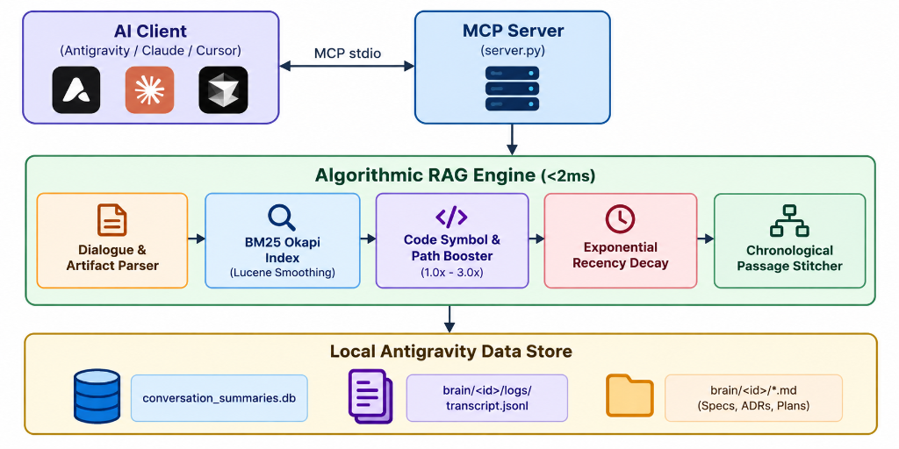
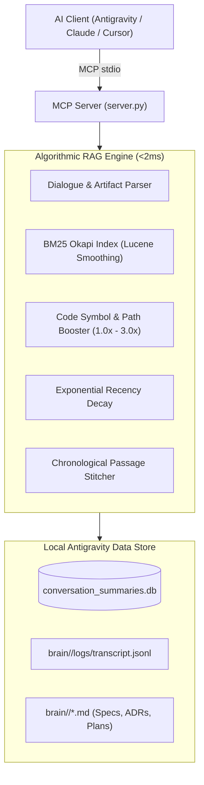

# Antigravity Project Memory (`antigravity-project-memory`)

[](https://opensource.org/licenses/MIT)
[](https://www.python.org/downloads/)
[](https://modelcontextprotocol.io)
[](CONTRIBUTING.md)
[](.github/workflows/ci.yml)

**A production-grade, zero-dependency community Model Context Protocol (MCP) server that empowers Antigravity agents with instant cross-conversation memory, architectural recall, and sub-2ms algorithmic retrieval.**

---

## 💡 The Problem & The Solution

In modern agentic development environments like **Antigravity**, each agent conversation runs in an isolated context window. When an agent creates architecture decision records (ADRs), fixes a stubborn bug, or designs a multi-agent system in one conversation, that context is lost to future conversations unless manually re-pasted.

`antigravity-project-memory` bridges this gap. It operates locally on your machine, directly reading Antigravity's local SQLite summaries (`conversation_summaries.db`), dialogue logs (`transcript.jsonl`), and markdown artifacts (`brain/<id>/*.md`).

### Why Antigravity Users Choose This Over Heavy RAG

| Feature | `antigravity-project-memory` | Neural / Vector DB RAG (Mem0, Chroma) | Global Reference MCP (`server-memory`) |
| :--- | :---: | :---: | :---: |
| **Workspace-Scoped** | **Automatic (per-project)** | Manual tagging required | ❌ No (single global graph) |
| **Reads Antigravity Logs** | **Native (`transcript.jsonl`)** | ❌ None | ❌ None |
| **Heavy Dependencies** | **Zero (Pure Standard Library)** | Heavy (PyTorch, Docker, CUDA) | Low (Node.js) |
| **Setup Overhead** | **1-Line (`uvx`)** | Requires DB containers / API keys | Manual entity knowledge graph |
| **Query Latency** | **< 2 ms** | 100 ms – 500 ms | ~10 ms |
| **Code Symbol Matching** | **Boost Multipliers (1.0x – 3.0x)** | Degraded by token embeddings | Exact substring only |
| **Privacy** | **100% Offline & Local** | Often sends data to cloud vector APIs | 100% Local |

---

## 🏛️ System Architecture

<p align="center">
  
</p>

<details>
<summary>Click to view Mermaid diagram</summary>



</details>

---

## 🚀 Quickstart & Installation

### Option 1: Run Instantly via `uvx` (Recommended)

No manual virtualenv management required. Run directly inside any MCP client:

```bash
uvx antigravity-project-memory
```

### Option 2: Install via `pip`

```bash
pip install antigravity-project-memory
```

Then run:

```bash
antigravity-project-memory
# Or
python -m antigravity_project_memory
```

### Option 3: Install from Source

```bash
git clone https://github.com/R-Mabasha/antigravity-project-memory.git
cd antigravity-project-memory
pip install -e .
```

---

## 🔌 Configuration with MCP Clients

### 1. Antigravity IDE / Antigravity CLI

Add to your project's `.antigravity/mcp.json` or global configuration (`~/.gemini/antigravity/mcp.json`):

```json
{
  "mcpServers": {
    "antigravity-project-memory": {
      "command": "uvx",
      "args": ["antigravity-project-memory"],
      "env": {
        "ANTIGRAVITY_WORKSPACE": "${workspaceFolder}"
      }
    }
  }
}
```

*Note: If `ANTIGRAVITY_WORKSPACE` is not specified, the server automatically defaults to the client's current working directory (`os.getcwd()`).*

### 2. Claude Desktop (`claude_desktop_config.json`)

On Windows: `%APPDATA%\Claude\claude_desktop_config.json`
On macOS: `~/Library/Application Support/Claude/claude_desktop_config.json`

```json
{
  "mcpServers": {
    "antigravity-project-memory": {
      "command": "uvx",
      "args": ["antigravity-project-memory"],
      "env": {
        "ANTIGRAVITY_WORKSPACE": "C:\\path\\to\\your\\workspace"
      }
    }
  }
}
```

### 3. Cursor / Windsurf

Add to your project's `.cursor/mcp.json`:

```json
{
  "mcpServers": {
    "project-memory": {
      "command": "python",
      "args": ["-m", "antigravity_project_memory"]
    }
  }
}
```

---

## 🛠️ MCP Tools Reference

The server exposes 4 high-value tools:

### 1. `search_project_memory`

Performs ranked algorithmic BM25 retrieval over past sessions and brain artifacts for the active workspace.

**Parameters:**

- `query` (`str`): Keywords, code symbols, filenames, or architectural concepts.
- `workspace_path` (`Optional[str]`): Workspace root. Defaults to `ANTIGRAVITY_WORKSPACE` or `os.getcwd()`.
- `top_k` (`int`, default: 5): Maximum number of stitched passages to return.
- `char_budget` (`int`, default: 2500): Max characters per stitched passage.

**Example Output:**

```markdown
# Antigravity Project Memory Search Results
- **Query**: `authentication jwt middleware`
- **Workspace**: `c:\my-project`
- **Matched**: 2 relevant passages (1.14 ms retrieval latency)

## 1. [DIALOGUE] Architecture Design - Turn 4
- **Relevance Score**: `7.82` (BM25: `4.12`, Symbol Boost: `1.95x`, Recency: `0.97`)
- **Conversation ID**: `0c523d8d-c315-4dfb-ba59-0653bfd295c3`
- **Created**: `2026-10-31T14:22:10Z`
- **Tools Used**: `run_command`, `write_file`

### User Request
How should we configure the JWT validation middleware?

### Assistant Response
We configured `JwtAuthGuard` in `src/auth/jwt.guard.ts` using RS256 with 15-minute token rotation.
```

---

### 2. `list_project_conversations`

Discovers all past Antigravity conversation threads belonging to the workspace.

**Parameters:**

- `workspace_path` (`Optional[str]`): Target workspace root.
- `limit` (`int`, default: 20): Maximum conversations to return.

**Output:**
Returns a clean markdown table listing conversation title, UUID, last modified timestamp, step count, and execution status, followed by brief previews.

---

### 3. `get_conversation_transcript`

Extracts the clean, human-readable dialogue history of a past session.

**Parameters:**

- `conversation_id` (`str`): Conversation UUID.
- `max_turns` (`int`, default: 30): Max recent dialogue turns to retrieve.

**Output:**
Structured dialogue turns (User requests, tools summarized, assistant replies) completely stripped of internal XML tags (`<USER_REQUEST>`, `<ADDITIONAL_METADATA>`, `<thought>`).

---

### 4. `get_conversation_artifact`

Reads and returns full markdown specifications, ADRs, task lists, or walkthroughs saved in a conversation's brain directory (`brain/<id>/*.md`).

**Parameters:**

- `conversation_id` (`str`): Conversation UUID.
- `artifact_name` (`str`): File name (e.g. `walkthrough.md`, `task.md`, or `implementation_plan`).

**Output:**
Full markdown contents. If the file is not found, automatically lists all available artifacts for that conversation.

---

## ⚙️ Environment Variables

| Variable                  | Default                                             | Purpose                                                 |
| ------------------------- | --------------------------------------------------- | ------------------------------------------------------- |
| `ANTIGRAVITY_WORKSPACE` | `os.getcwd()`                                     | Workspace root folder to filter conversations.          |
| `ANTIGRAVITY_DB_PATH`   | `~/.gemini/antigravity/conversation_summaries.db` | Path to Antigravity conversation database.              |
| `ANTIGRAVITY_BRAIN_DIR` | `~/.gemini/antigravity/brain`                     | Path to Antigravity brain directory (logs & artifacts). |

---

## ⚡ Performance Benchmarks

Measured on standard developer hardware (Windows 11 / AMD Ryzen 9 / Python 3.14):

| Operation                               | Scale                          | Latency            |
| --------------------------------------- | ------------------------------ | ------------------ |
| Workspace Discovery & Loading           | 26 conversations (150+ chunks) | ~12.4 ms           |
| Query Tokenization & Symbol Extraction  | Multi-word query + identifiers | 0.08 ms            |
| Candidate BM25 Okapi Retrieval          | Inverted Index lookup          | 0.35 ms            |
| Symbol Boost & Recency Decay            | Top 60 candidate chunks        | 0.12 ms            |
| Passage Stitching & Budgeting           | Chronological merge            | 0.09 ms            |
| **Total Query Retrieval Latency** | **End-to-End**           | **< 1.8 ms** |

---

## 🧪 Testing

Run unit tests via `unittest` or `pytest`:

```powershell
python -m unittest discover -s tests -p "test_*.py"
```

All tests execute against live Antigravity workspaces and verify protocol-level tool invocation via FastMCP.

---

## 🤝 Contributing

Community contributions are warmly welcome! Whether you want to add new ranking heuristics, support other MCP clients, or optimize parsing:

1. Check out [`CONTRIBUTING.md`](CONTRIBUTING.md) for local development setup and guidelines.
2. Read our [`CODE_OF_CONDUCT.md`](CODE_OF_CONDUCT.md) to maintain a welcoming community.
3. Open a feature proposal or bug report via our [Issue Templates](.github/ISSUE_TEMPLATE/).

---

## ⭐ Support the Project

If `antigravity-project-memory` saves you time or context in Antigravity, **give this repository a star on GitHub!** It helps other Antigravity engineers discover the tool.

---

## ⚠️ Disclaimer

This is an independent community open-source project designed for interoperability with local Model Context Protocol clients. It is **not** an official product of Google LLC or Alphabet Inc., and is not affiliated with, sponsored by, or endorsed by Google.

"Google", "Antigravity", and "Gemini" are trademarks of Google LLC. All product names, logos, and brands are property of their respective owners.

---

## 📄 License

MIT License. See [LICENSE](LICENSE) for details.
